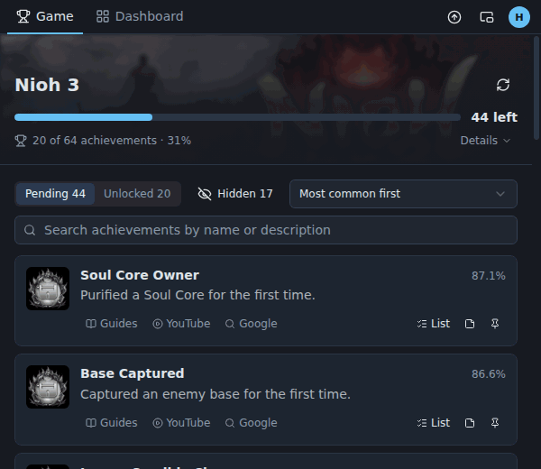
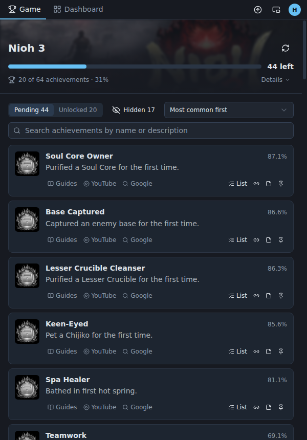
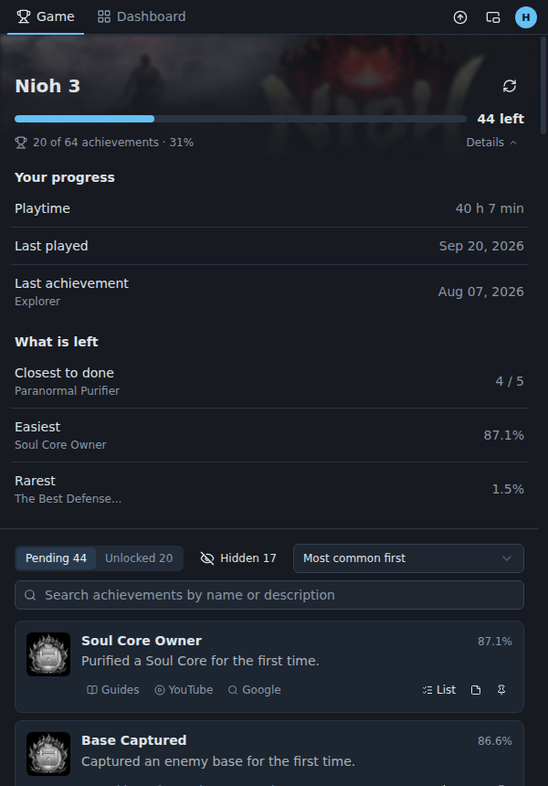
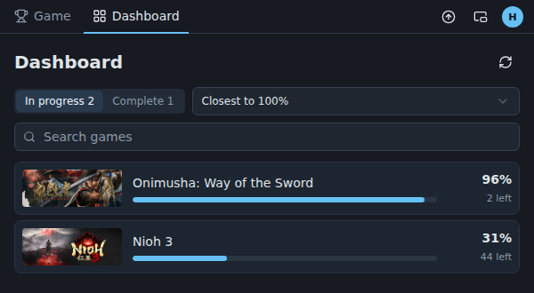
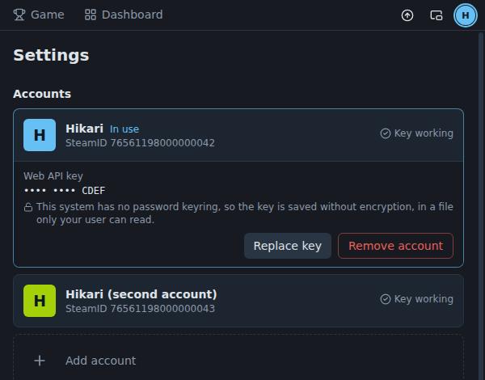
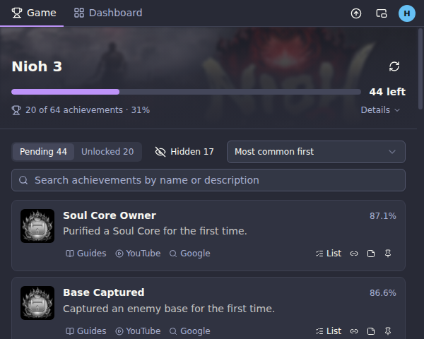
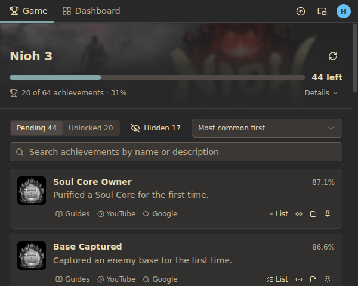
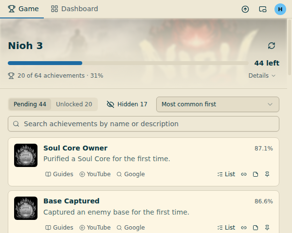
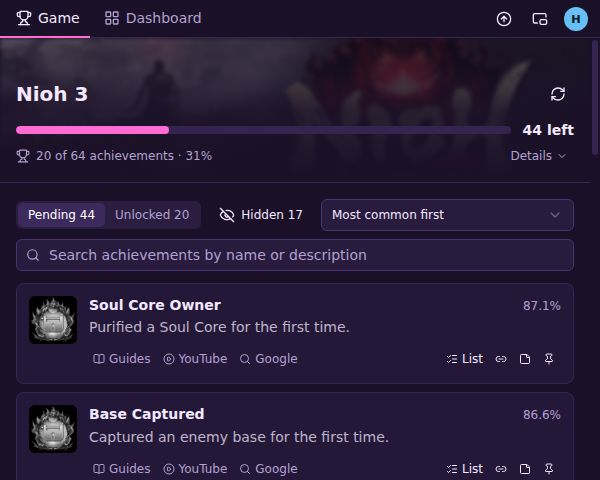

<p align="center">
  
</p>

<h1 align="center">Trophy Tracker</h1>

<p align="center">
  Voyez ce qu’il vous reste dans le jeu Steam auquel vous jouez, sans quitter le jeu.
</p>

<p align="center">
  <a href="https://github.com/joaosoarees/trophy-tracker/releases/latest"></a>
  <a href="https://github.com/joaosoarees/trophy-tracker/actions/workflows/ci.yml"></a>
  <a href="https://codecov.io/gh/joaosoarees/trophy-tracker"></a>
  
  <a href="LICENSE"></a>
</p>

<p align="center">
  <a href="README.md">English</a> · <a href="README.pt-BR.md">Português</a> · <a href="README.es.md">Español</a> · <strong>Français</strong>
</p>

<p align="center">
  
</p>

Steam liste les succès qui vous manquent sans dire comment les obtenir, cache ceux qui sont cachés et répartit votre progression sur une page par jeu. Trophy Tracker est une fenêtre étroite posée à côté du jeu, sur un second écran, qui répond à la question qu’un chasseur de succès se pose sans cesse : **que reste-t-il, et comment l’obtenir ?**

Il est gratuit, open source et n’est affilié ni à Valve ni à Steam.

## Ce qu’il fait

<table>
  <tr>
    <td width="50%" valign="top">
      <h3>Il suit le jeu que vous lancez</h3>
      <p>Lancez un jeu sur Steam et l’application y passe d’elle-même. Sans jeu ouvert, elle montre le dernier auquel vous avez joué. Un succès déverrouillé pendant que vous jouez apparaît tout seul, avec le nombre de ceux qui restent.</p>
      <h3>Les succès cachés, révélés</h3>
      <p>Le nom et la description des succès que Steam cache, la rareté de chacun et les compteurs de progression de Steam, pour les jeux qui en ont.</p>
      <h3>Un guide en un clic</h3>
      <p>Chaque succès ouvre une recherche sur la façon de l’obtenir, dans les guides de la communauté Steam, sur YouTube ou sur Google.</p>
    </td>
    <td width="50%">
      
    </td>
  </tr>
  <tr>
    <td width="50%">
      
    </td>
    <td width="50%" valign="top">
      <h3>Ce que Steam ne suit pas, vous le suivez</h3>
      <p>Steam ne vous dit pas quels objets à collectionner il vous manque. Chaque succès peut porter votre propre liste, une note, une épingle et un lien vers la vidéo ou le guide que vous suivez, conservés sur votre ordinateur d’une session à l’autre.</p>
      <h3>Tous les jeux, selon ce qu’il leur reste</h3>
      <p>Un tableau de bord liste ce à quoi vous avez joué, trié selon la proximité de chaque jeu avec les 100 %, et un jeu terminé reçoit la seule célébration de l’application.</p>
      <p></p>
    </td>
  </tr>
  <tr>
    <td width="50%" valign="top">
      <h3>Plusieurs comptes</h3>
      <p>Ajoutez plusieurs comptes Steam et passez de l’un à l’autre en un clic ; chacun garde sa propre clé, ses notes, ses listes et ses liens. L’application suit le compte connecté à Steam.</p>
      <h3>Dans votre langue</h3>
      <p>Anglais, portugais du Brésil, espagnol et français. La langue change toute l’application, y compris les noms des succès envoyés par Steam.</p>
    </td>
    <td width="50%">
      
    </td>
  </tr>
</table>

### À vos couleurs

Cinq thèmes : Navy, celui avec lequel l’application démarre et celui des images ci-dessus, et Dracula, Gruvbox, Solarized Light et Synthwave. Chaque compte garde le sien : changer de compte change donc aussi les couleurs. Tous les thèmes passent la même vérification de contraste.

<p>
  
  
  
  
</p>

## Téléchargement

Récupérez l’installateur de votre système dans la [dernière version](https://github.com/joaosoarees/trophy-tracker/releases/latest):

| Système | Fichier                                                                                      |
| ------- | -------------------------------------------------------------------------------------------- |
| Windows | `Trophy-Tracker-<version>-Windows.exe`                                                       |
| macOS   | `Trophy-Tracker-<version>-macOS-arm64.dmg` (Apple Silicon) ou `-macOS-x64.dmg` (Intel)       |
| Linux   | `Trophy-Tracker-<version>-Linux.AppImage` (toute distribution) ou `-Linux-Debian-Ubuntu.deb` |

Au premier lancement, l’application demande une langue, votre SteamID et votre propre [clé de l’API Web Steam](https://steamcommunity.com/dev/apikey), et vérifie que les détails de jeu de votre profil sont publics. Sous Windows et avec l’AppImage Linux, elle se tient ensuite à jour toute seule ; sous macOS et avec le `.deb`, elle vous prévient quand une nouvelle version existe.

**Les installateurs ne sont pas signés**, et aucune date n’est prévue pour que cela change ; le système avertit donc au premier lancement :

- **Windows :** sur l’avertissement SmartScreen, choisissez « Informations complémentaires » puis « Exécuter quand même ». Si le **Contrôle intelligent des applications** est activé (Sécurité Windows → Contrôle des applications et du navigateur), Windows peut refuser d’exécuter l’installateur, sans moyen de l’autoriser.
- **macOS :** après la première tentative d’ouverture, allez dans Réglages Système → Confidentialité et sécurité et choisissez « Ouvrir quand même ».
- **Linux :** `sudo apt install ./Trophy-Tracker-<version>-Linux-Debian-Ubuntu.deb`, ou rendez l’AppImage exécutable (`chmod +x`) et lancez-la.

Ce qui a changé dans chaque version est dans le [journal des modifications](CHANGELOG.md), en anglais.

## Confidentialité

Trophy Tracker n’a ni compte, ni serveur, ni télémétrie. Il ne communique qu’avec :

- **Steam** (`api.steampowered.com` et les serveurs d’images de Steam), avec la clé de l’API Web et le SteamID que vous fournissez, pour lire vos jeux et vos succès ;
- **GitHub** (`api.github.com` et `github.com`), pour chercher une version plus récente et, sous Windows et avec l’AppImage Linux, la télécharger.

Vos clés, notes, listes et liens ne sont conservés que sur votre ordinateur, dans `%APPDATA%\trophy-tracker` (Windows), `~/Library/Application Support/trophy-tracker` (macOS) ou `~/.config/trophy-tracker` (Linux). Une clé enregistrée n’est plus jamais affichée, seulement ses quatre derniers caractères. Les erreurs sont écrites dans un fichier journal local et ne sont jamais envoyées nulle part.

## Comment il est fait

Electron, React et TypeScript, avec le soin qu’un petit outil reçoit rarement :

- **Testé là où il décide quelque chose.** Plus de 1600 tests couvrent la logique qui lit Steam, conserve vos données et met l’application à jour. Ils tournent sous Windows, macOS et Linux à chaque envoi, et le badge ci-dessus dit quelle part de cette logique ils couvrent.
- **L’interface est auditée par un script, pas de mémoire.** `pnpm audit:ui` pilote l’application compilée face à un substitut de Steam : il parcourt la configuration initiale, chaque écran et les enchaînements qu’aucune image seule ne montre (un jeu qui démarre, un succès déverrouillé, Steam hors service), en vérifiant l’accessibilité avec axe, le focus clavier, le survol et les débordements. Les images de cette page viennent du même substitut.
- **Un catalogue de composants.** `pnpm storybook` montre chaque élément isolé, dans tous ses états, dans les quatre langues, dans les cinq thèmes et aux deux largeurs pour lesquelles la fenêtre est conçue.
- **Vos fichiers ne peuvent pas être perdus lors d’un plantage.** Chacun est écrit en entier avant de remplacer le précédent, et un fichier illisible est mis de côté, jamais écrasé.
- **Les versions se construisent toutes seules.** Une étiquette de version fait construire et tester les installateurs par GitHub Actions sur les trois systèmes, puis les publie avec leurs notes.
- **Un système de design écrit** ([DESIGN.md](DESIGN.md)) et les raisons des choix qui ne vont pas de soi ([docs/DECISIONS.md](docs/DECISIONS.md)).

## Développement

```bash
corepack enable   # une fois ; fournit la version de pnpm fixée dans package.json
pnpm install
pnpm dev          # l’application, avec rechargement
```

Le projet ne s’installe qu’avec pnpm. Sous WSL ou sur un Linux minimal, Electron a aussi besoin de `sudo apt install libnss3 libnspr4 libasound2t64`.

```bash
pnpm test && pnpm lint && pnpm typecheck
pnpm audit:ui      # l’audit de l’interface
pnpm storybook     # le catalogue de composants
pnpm dist          # les installateurs du système où vous êtes, dans dist/
pnpm screenshots   # les images de cette page
```

L’organisation du code et les règles que suit chaque modification sont dans [CLAUDE.md](CLAUDE.md) ; les règles de chaque domaine, ainsi que le fonctionnement des versions et de l’audit, dans [docs/](docs). Le code, les commentaires et la documentation du dépôt sont en anglais.

## Licence

[Apache 2.0](LICENSE)
